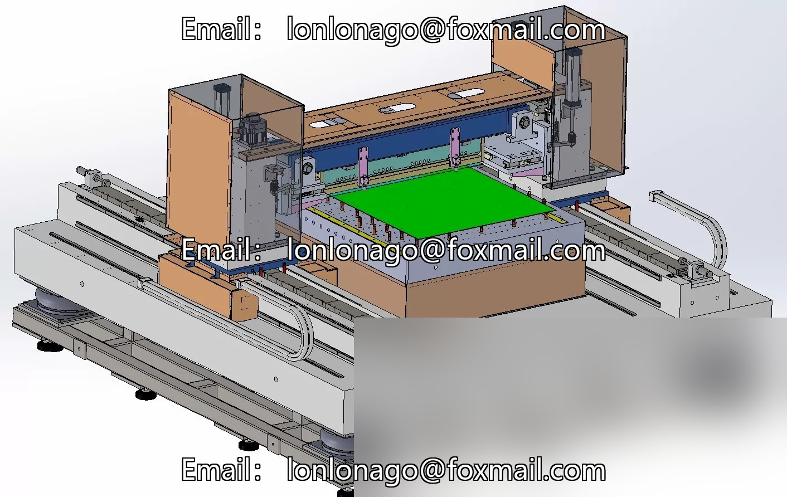
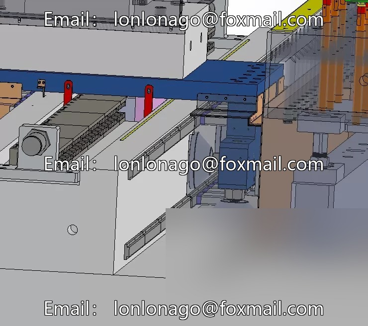

# High-precision air floating platform

## Body

High-precision air floating platform, high-precision platform, air floating bearing detection platform 3D drawing!
Semiconductor industry high-precision platform equipment for lithography, quantity inspection, cutting, etching, coating and other high-precision platforms!
Purchase can be gifted with relevant technical materials. Gifts include a single-air float axis 3D.

The image is empty; based on the title and body, it describes high-precision air-floating platforms, air-floating bearing detection platforms 3D drawings, semiconductor industry precision platforms, and related technical materials.

<!-- AI_ENRICHED -->

## Images

## Payment

Here is a pay link on Stripe ( https://buy.stripe.com/3cs8yP7sY87d0vu9AB ). Please contact me lonlonago@foxmail.com after funding $89, and I will send you a complete data files , thank you!

